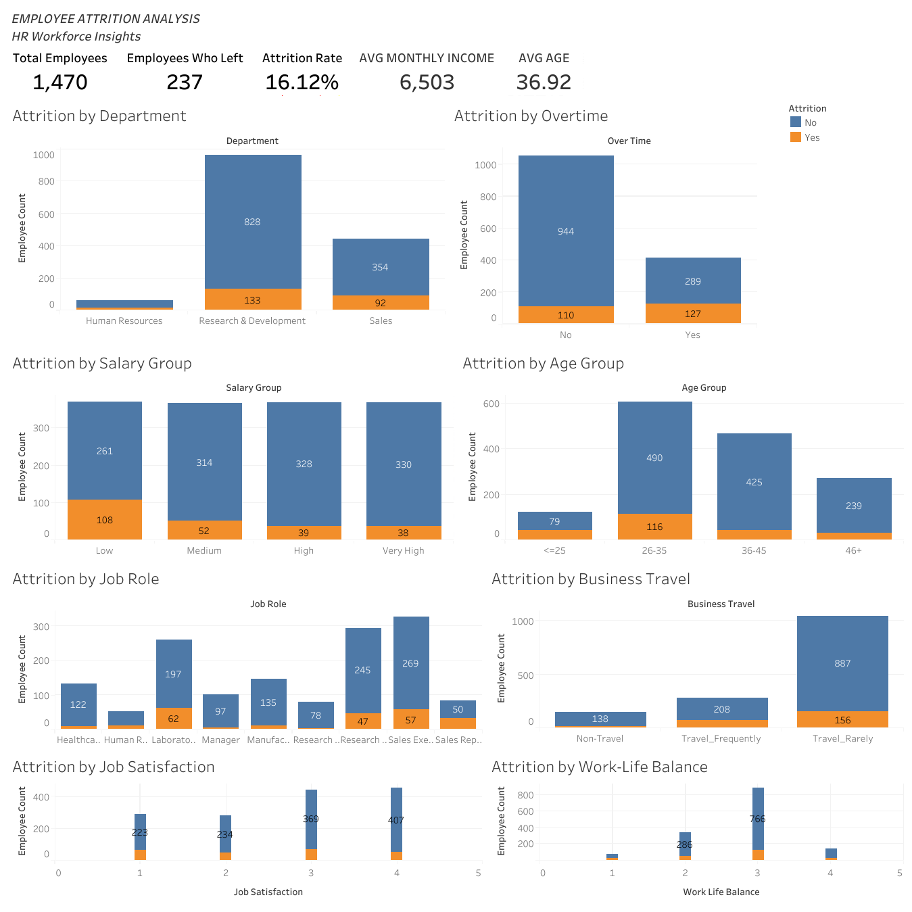

# Employee Attrition Analysis

An end-to-end HR analytics project that analyzes employee attrition patterns using Python for data cleaning and exploratory data analysis (EDA), and Tableau for interactive business visualization.

## 📌 Project Overview

Employee attrition is an important HR challenge that can affect productivity, recruitment costs, employee morale, and organizational performance.

This project analyzes an HR Employee Attrition dataset to identify patterns associated with employee turnover. The analysis focuses on factors such as overtime, salary, age, job role, business travel, job satisfaction, and work-life balance.

The project follows a complete data analytics workflow:

**Data → Cleaning → EDA → Visualization → Business Insights → Recommendations**

---

## 🎯 Objectives

- Understand the structure and characteristics of the HR dataset.
- Identify and handle data quality issues.
- Analyze overall employee attrition.
- Study attrition across different employee segments.
- Analyze the relationship between attrition and factors such as:
  - Overtime
  - Salary
  - Age
  - Job Role
  - Business Travel
  - Job Satisfaction
  - Work-Life Balance
- Identify important patterns through exploratory data analysis.
- Build an interactive Tableau dashboard.
- Generate business insights and recommendations.

---

## 📊 Dataset

The dataset contains employee-level HR information including demographic, job-related, compensation, satisfaction, and employment-history information.

### Dataset Summary

| Metric | Value |
|---|---:|
| Total Employees | 1,470 |
| Total Columns | 35 |
| Employees Who Left | 237 |
| Employees Who Stayed | 1,233 |
| Attrition Rate | 16.12% |
| Average Age | 36.92 |
| Average Monthly Income | 6,502.93 |

### Target Variable

**Attrition**

- `Yes` → Employee left the organization
- `No` → Employee stayed in the organization

---

## 🧹 Data Cleaning

The dataset was checked and prepared before analysis.

### Cleaning steps

- Checked for missing values.
- Checked for duplicate records.
- Identified constant-value columns.
- Removed unnecessary identifier columns.
- Performed logical validation of employee experience fields.

### Results

- **Missing values:** 0
- **Duplicate records:** 0
- **Invalid YearsAtCompany > TotalWorkingYears records:** 0

The following constant columns were removed:

- `EmployeeCount`
- `Over18`
- `StandardHours`

`EmployeeNumber` was also removed because it is an employee identifier rather than an analytical feature.

---

## 🔍 Exploratory Data Analysis

The analysis examined employee attrition across multiple dimensions.

### Key areas analyzed

- Attrition by Department
- Attrition by Overtime
- Attrition by Salary Group
- Attrition by Age Group
- Attrition by Job Role
- Attrition by Business Travel
- Attrition by Job Satisfaction
- Attrition by Work-Life Balance

Interaction analysis was also performed for:

- Age + Overtime
- Salary + Overtime

---

## 📈 Key Findings

### 1. Overtime and Attrition

Employees working overtime had an observed attrition rate of **30.53%**, compared with **10.44%** among employees who did not work overtime.

### 2. Younger Employees

Employees aged 25 or below had an observed attrition rate of **35.77%**, compared with **9.19%** among employees aged 36–45.

### 3. Salary

The low-salary group had an observed attrition rate of **29.27%**, while the very-high-salary group had an observed attrition rate of **10.33%**.

### 4. Job Roles

Sales Representatives had the highest observed attrition rate at **39.76%**, while Research Directors had the lowest at **2.50%**.

### 5. Business Travel

Employees who travelled frequently had an observed attrition rate of **24.91%**, compared with **8.00%** among employees who did not travel.

### 6. Job Satisfaction

Employees with the lowest job satisfaction score had an observed attrition rate of **22.84%**, compared with **11.33%** for employees with the highest satisfaction score.

### 7. Combined Patterns

Employees aged 25 or below who worked overtime had an observed attrition rate of **64.10%**.

Employees in the low-salary group who worked overtime had an observed attrition rate of **58.49%**.

---

## 💡 Business Recommendations

Based on the observed patterns, the following recommendations were developed:

1. **Review overtime and workload**  
   Review overtime requirements, workload distribution, and staffing levels.

2. **Strengthen early-career retention**  
   Improve onboarding, mentorship, training, and career-development opportunities.

3. **Review compensation and salary progression**  
   Examine compensation competitiveness and salary progression, particularly for employees with high workload requirements.

4. **Develop role-specific retention strategies**  
   Investigate workload, career progression, compensation, and working conditions in high-attrition roles.

5. **Focus on high-risk combinations**  
   Prioritize further investigation of segments such as younger employees with overtime and lower-salary employees with overtime.

6. **Monitor employee satisfaction**  
   Conduct regular employee engagement and satisfaction surveys.

---

## 📊 Tableau Dashboard

An interactive Tableau dashboard was created to provide a visual summary of employee attrition.

### Dashboard KPIs

- Total Employees
- Employees Who Left
- Attrition Rate
- Average Monthly Income
- Average Age

### Dashboard Visualizations

- Attrition by Department
- Attrition by Overtime
- Attrition by Salary Group
- Attrition by Age Group
- Attrition by Job Role
- Attrition by Business Travel
- Attrition by Job Satisfaction
- Attrition by Work-Life Balance

### Dashboard Preview



### 🔗 Interactive Tableau Dashboard

**[View the Interactive Tableau Dashboard](https://public.tableau.com/app/profile/varun.kaushik.ch/viz/EmployeeAttritionAnalysisDashboard_17896609093620/Dashboard1)**


---

## 🛠️ Tools & Technologies

- **Python**
- **Pandas**
- **Matplotlib**
- **Seaborn**
- **Jupyter Notebook**
- **Tableau**
- **Microsoft Word**

---

## ⚠️ Limitations

- This analysis identifies patterns and associations, not direct cause-and-effect relationships.
- The dataset represents a single HR dataset and may not reflect all industries or organizations.
- Some employee categories contain fewer records, which may affect comparisons.
- The analysis is based on historical data and does not predict future attrition.
- Additional factors such as employee feedback, performance reviews, and organizational culture were not available in the dataset.

---

## 🏁 Conclusion

This project presents an end-to-end Employee Attrition Analysis using Python and Tableau.

The analysis identified important attrition patterns across overtime, age, salary, job role, business travel, job satisfaction, and work-life balance.

Employees with overtime, lower salaries, frequent travel, lower satisfaction, and younger age groups showed higher attrition levels.

The Tableau dashboard provides an interactive way for HR teams to monitor workforce trends and identify areas requiring attention.

These findings can support data-driven HR decisions and help organizations improve employee retention strategies.

---

## 👤 Author

**Varun Kaushik**  
B.Tech CSE  
Gokaraju Lailavathi Engineering College

---

## 📁 Project Structure

```text
Employee_Attrition_Analysis/
│
├── data/
│   ├── raw/
│   │   └── WA_Fn-UseC_-HR-Employee-Attrition.csv
│   │
│   └── cleaned/
│       └── employee_attrition_tableau.csv
│
├── notebooks/
│   └── employee_attrition_analysis.ipynb
│
├── visualizations/
│   ├── attrition_by_department.png
│   ├── attrition_by_overtime.png
│   ├── attrition_by_salary_group.png
│   ├── attrition_by_age_group.png
│   ├── attrition_by_job_role.png
│   ├── attrition_by_business_travel.png
│   ├── attrition_by_job_satisfaction.png
│   ├── attrition_by_worklife_balance.png
│   └── Tableau_Dashboard.png
│
├── reports/
│   ├── Employee Attrition Analysis.docx
│   └── Tableau/
│       └── Employee Attrition Analysis Dashboard.twbx
│
└── README.md